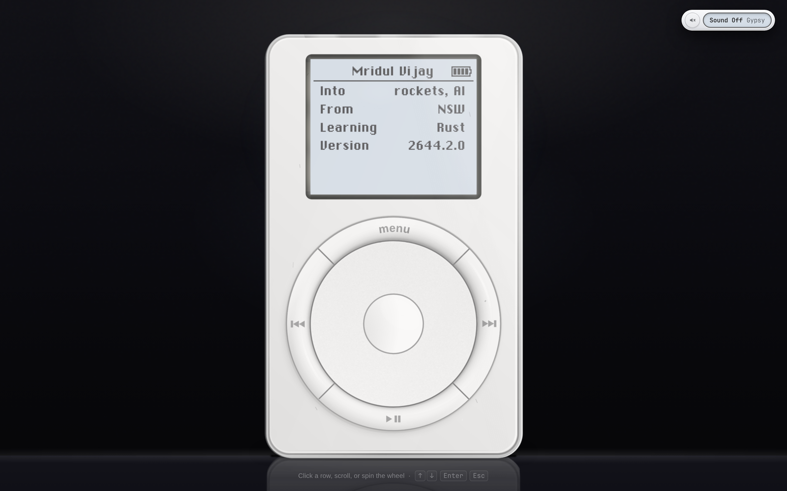

# lucasian.tech

My personal site that looks like an iPod.


[lucasian.tech](https://lucasian.tech)

You can use the iPod scroll wheel and menu to navigate, or use a mouse and keyboard.

## What it does

- music, projects, about, and contacts rows
- 8 songs from my library
- pause and skip from the menu
- the iPod can slightly tilt
- arrow keys, `Enter`, `Escape`, and `Space` also work

## Screenshots

|  |  |
| --- | --- |
|  |  |


## How I made it

The site is plain HTML, CSS, and JavaScript. The iPod is `web-music-ipod`, a custom element where I replaced its catalog with music, projects, about, and contacts.

Making it responsive and work on phones took a lot of effort, as the iPod kept loading out of frame. I had to recalculate how the viewport changes and test edge cases.

`deploy.sh` hashes `app.js`, `styles.css`, and the player, stamps the hash into `index.html`, and pushes the folder to Cloudflare Pages. That keeps the edge cache from serving an old player.

## Run it locally

```sh
git clone https://github.com/lucasian-max/lucasian-tech.git
cd lucasian-tech
python3 -m http.server 8123 --bind 127.0.0.1
```

Open `http://127.0.0.1:8123/`.

Node 20 or newer is only for the tests and the deploy script.

## Tests

Three headless Chromium test scripts. No npm packages.

```sh
node tests/verify.mjs
node tests/music.mjs
node tests/mobile.mjs
```

## Built with

- vanilla JavaScript, HTML, and CSS
- HTML5 audio
- Cloudflare Pages and Wrangler
- Navidrome for the music

## AI disclosure

AI helped with parts of the player wiring and the design. The final edits are mine.
