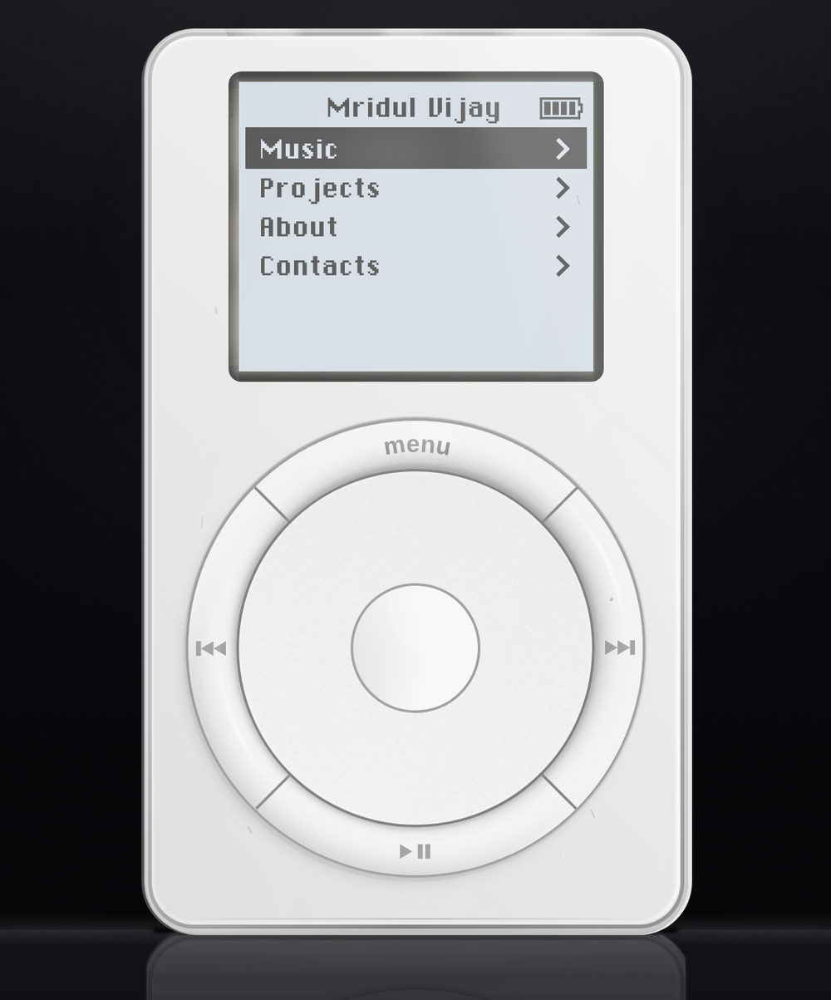
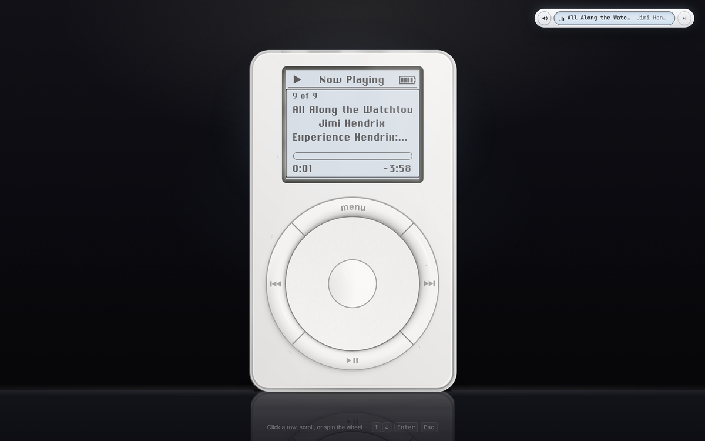

# lucasian.tech

my personal site. it's a working 2004 iPod with my projects and 8 songs.



[lucasian.tech](https://lucasian.tech)

you can use a mouse, trackpad, keyboard, or finger. nothing to install.



## what it does

- music, projects, about, and contacts, on the wheel and on the LCD rows
- 8 full songs from my library, not 30 second previews
- pause and skip from the inline remote in the corner
- press Music while a song is playing and it opens Now Playing
- drag the chassis and it tilts. the highlight and scratches move with it
- arrow keys, Enter, Escape, and Space also work
- it fits a phone, and the song list scrolls with a finger

## how i made it

the site is plain HTML, CSS, and JavaScript. no build step, no framework.

the iPod is `web-music-ipod`, a custom element I patched. I replaced its catalog with `window.__SITE` in `app.js`, wired the LCD rows and wheel to a small bridge, and made Now Playing and the remote share one playback state.

the first version used 30 second iTunes previews. those URLs kept dying. the songs now come from my Navidrome library, converted to 112 kbps MP3 and committed in `assets/audio/`. the catalog is `includes/ipod/data/us/en-US.json`.

on a phone I drop the 3D tilt, the blur, and the noise. the catalog preloads and the song list pans with a finger.

`deploy.sh` hashes `app.js`, `styles.css`, and the player, stamps the hash into `index.html`, and pushes the folder to Cloudflare Pages. that keeps the edge cache from serving an old player.

## run it locally

python is enough.

```sh
git clone https://github.com/lucasian-max/lucasian-tech.git
cd lucasian-tech
python3 -m http.server 8123 --bind 127.0.0.1
```

open `http://127.0.0.1:8123/`.

node 20 or newer is only for the tests and the deploy script.

## tests

three headless Chromium test scripts. no npm packages.

```sh
node tests/verify.mjs
node tests/music.mjs
node tests/mobile.mjs
```

`verify.mjs` checks the menu, LCD clicks, full songs, and the phone layout. `music.mjs` covers the remote, pause and resume, skipping, the Music row, Now Playing, touch taps, and the end of the queue. `mobile.mjs` checks phone width, scale, remote bounds, the touch hint, and that the tilt is off.

`music.mjs` can hang when audio starts on some machines. `mobile.mjs` is the quick check I trust.

## built with

- vanilla JavaScript, HTML, and CSS
- the `web-music-ipod` custom element, patched for this site
- HTML5 audio
- Cloudflare Pages and Wrangler
- Navidrome and `ffmpeg` for the music
- headless Chromium and the Chrome DevTools Protocol for tests

## ai disclosure

AI helped with parts of the player wiring, the tests, and the first draft of this README. the design, the music library, and the final edit are mine.

## credits

thanks to the people behind `web-music-ipod`, and to the artists whose music is here.
